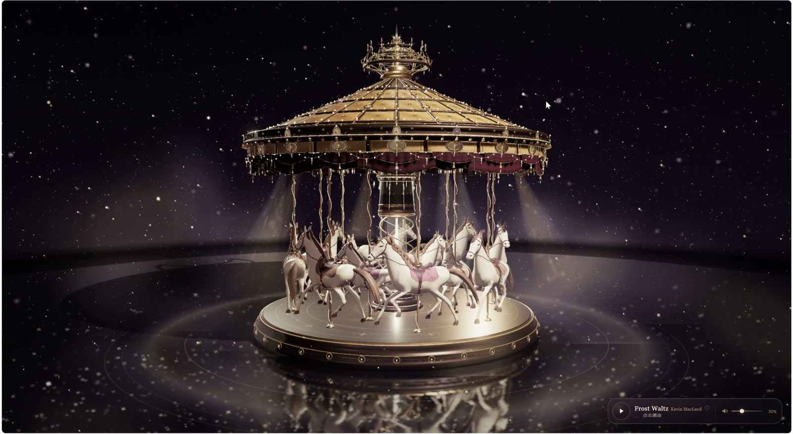
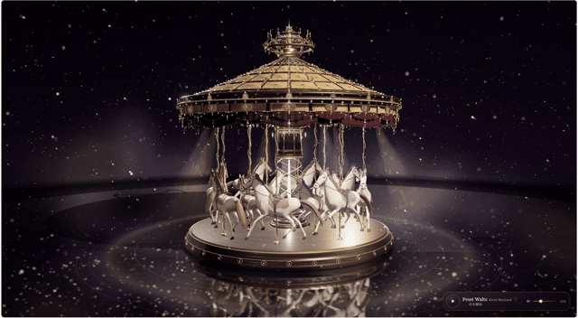
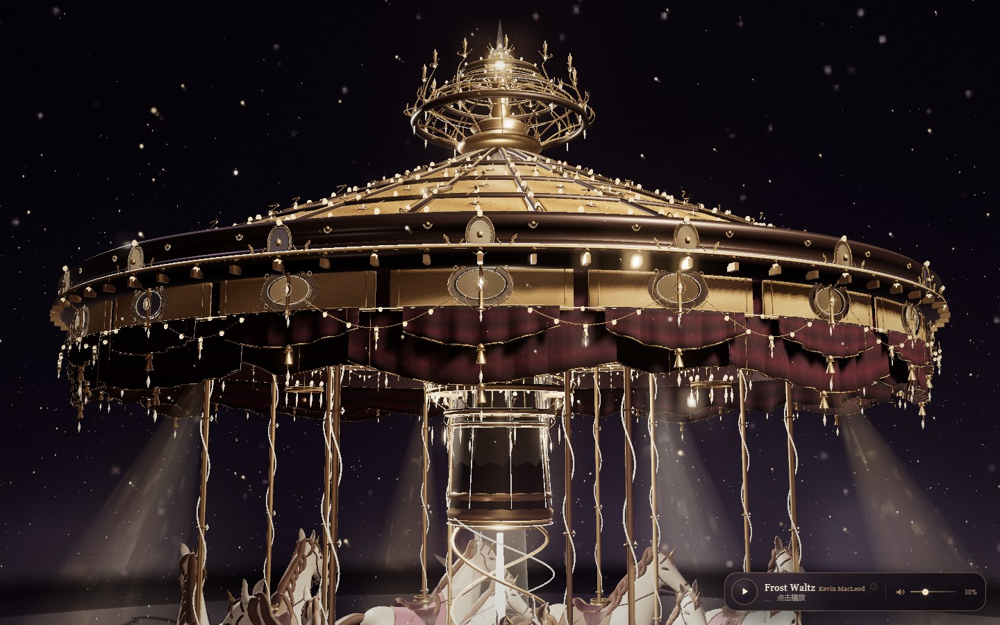
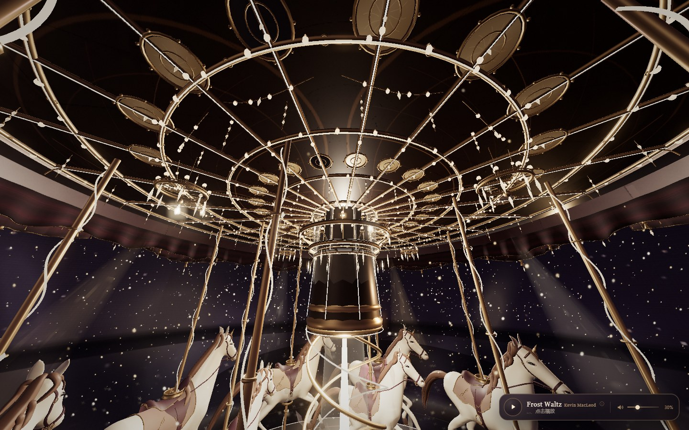
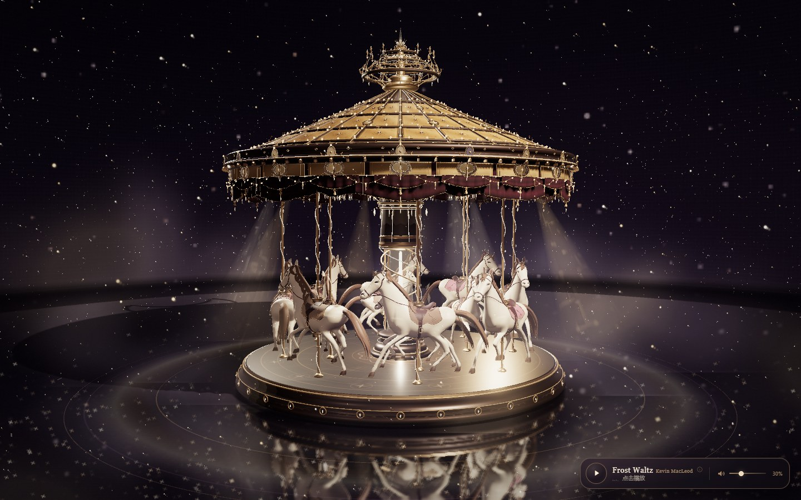
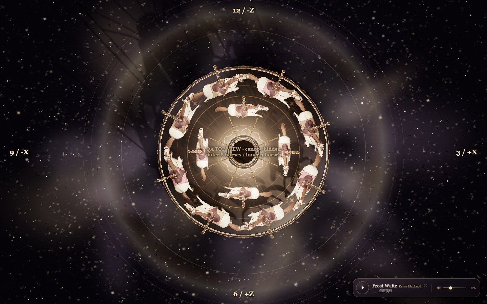
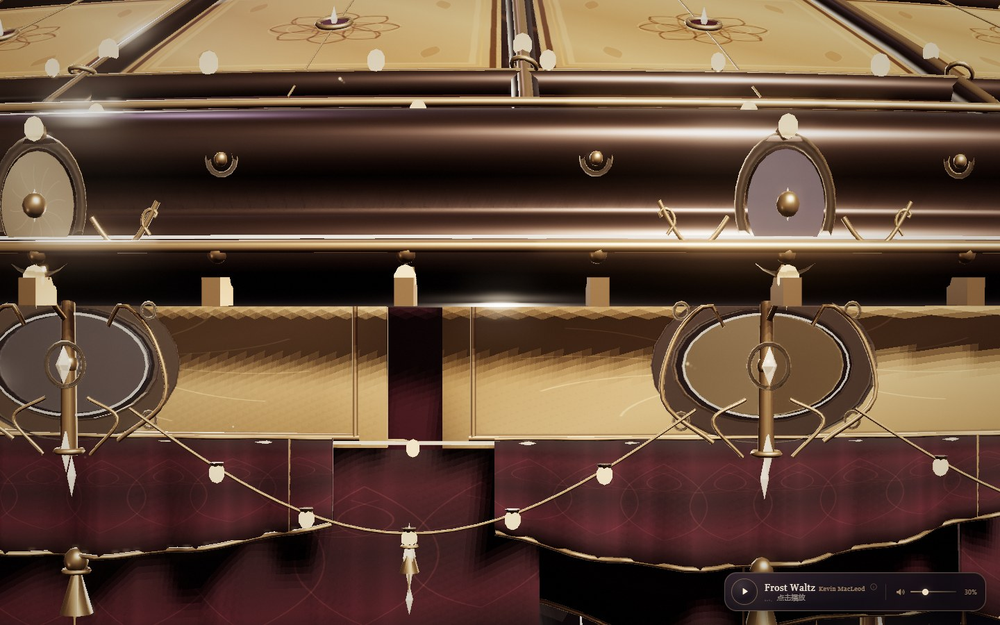
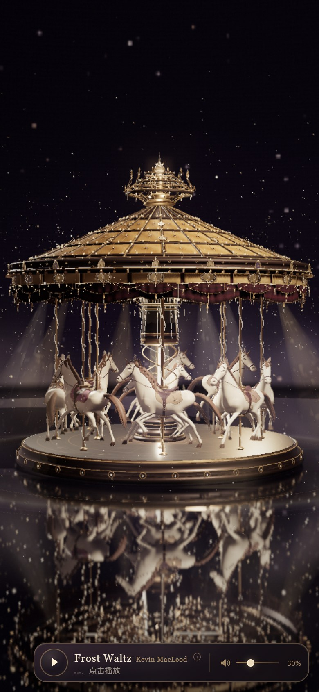

# 霓虹旋转木马 · 梦幻夜曲

  <b>一座会在午夜醒来的 Belle Époque 旋转木马</b> 
  Three.js · WebGL 2 · 单文件离线 · 五层宫廷冠顶 · 双环独立反向旋转

  

  <a href="docs/media/carousel-demo.mp4">▶ 观看 12.7 秒演示</a>
  ·
  <a href="霓虹旋转木马-梦幻夜曲.html">⬇ 下载单文件 HTML</a>
  ·
  <a href="source/">浏览源码</a>
  ·
  <a href="source/双环旋转验收报告.md">双环验收报告</a>

  

GIF 为录屏节选；完整视频见上方链接。视频由项目作者录制，已裁去浏览器边框并转码为 1280 × 702 / 30fps；原始 120fps 录屏保留在本地，未入库。

---

## 这是什么

一个完全程序化生成的 Three.js 旋转木马夜景：12 匹实体雕塑木马、五层可近距离观赏的宫廷冠顶、上千颗独立灯珠、内嵌背景音乐，以及**建筑静止、内外两圈木马独立反向公转**的机械运动。

最终交付是一个 **4.48 MB 单文件 HTML**。双击即可运行，不需要服务器，不请求外部模型、贴图或音乐；代码、纹理、音频和预览都在仓库中。

项目最初来自一份「梦幻赛博朋克」旋转木马 brief；经过音乐、冠顶和机械运动三轮迭代，最终成为现在的香槟金 / 深酒红 Belle Époque 版本。每一轮的用户原始提示都保留在 [docs/PROMPTS.md](docs/PROMPTS.md)，并完整附在本文末尾。

## 数字一览

| | |
|---|---|
| **木马** | 12 匹；外圈 8、内圈 4；两套姿态与多种鞍布配色 |
| **冠顶** | 5 层；24 条径向骨架；4 道加强环；20 块雕花冠板；3 级檐口 |
| **灯饰** | 1,177 颗灯珠；710 颗水晶；4 组灯珠 InstancedMesh；3 个代表性局部光源 |
| **运动** | 外圈 8 匹顺时针 −0.12 rad/s；内圈 4 匹逆时针 +0.15 rad/s；建筑主体 0 rad/s |
| **音乐** | 135 秒完整曲目；160 kbps MP3 data URI；单 Audio 元素；默认暂停、30% 音量 |
| **文件** | 单文件 4.48 MB；Three.js r180；内联 bundle；无运行时外链 |

## 亮点

### 01 · Belle Époque 五层冠顶

- 三层金属圆环、12 道尖拱和 12 支实心冠尖组成顶部皇冠。
- 24 条骨架、4 道加强环、72 块奶金色嵌板和 24 件浮雕饰板构成穹顶。
- 20 块独立冠板、20 根立体壁柱、3 级檐口和 80 个齿饰围成外圈。
- 20 幅短垂幔、连续波浪裙摆、10 幅长丝绒帘，配金色包边、流苏和珠链。
- 灯光天花板有 6 道同心圆、24 根径向梁、48 个镜面/象牙嵌饰、中央环吊灯与 4 盏外围吊灯。

完整结构见 [冠顶升级验收报告](source/冠顶升级验收报告.md)。

### 02 · 双环独立反向旋转

整个建筑是静态根节点；只有位于场景中心 <code>(0, 0, 0)</code> 的两个 Pivot 旋转：

- **outerHorseRingPivot**：8 匹，顺时针，−0.12 rad/s。
- **innerHorseRingPivot**：4 匹，逆时针，+0.15 rad/s。
- 木马原有上下起伏和轻微倾摆保留；支撑杆与所属环同步公转，但不跟随木马起伏。
- 两圈木马按环拆分为独立 InstancedMesh 组；没有整体旋转、每匹马自转或每帧重建几何体。

方向验证、30 秒运行和 Tab 切换数据见 [双环旋转验收报告](source/双环旋转验收报告.md)。

### 03 · 内嵌梦幻华尔兹

**Frost Waltz** — Kevin MacLeod（2008），约 99 BPM 的 3/4 拍华尔兹；钟琴/钢片琴主奏，弦乐与法国号铺底。

- 默认暂停；点击播放后 2 秒淡入，暂停时 1 秒淡出。
- 30% 默认音量、静音、滑杆和动态电平条。
- 单 Audio 元素循环；页面隐藏暂停，返回后恢复。
- 完整曲目以 160 kbps MP3 data URI 内嵌，离线可播放。
- 许可：**CC BY 3.0**；署名与许可证在页内 ⓘ 面板、[CREDITS](source/assets/music-src/CREDITS.md)、[许可证全文](source/assets/music-src/LICENSE-CC-BY-3.0.txt) 和 [第三方声明](THIRD_PARTY_NOTICES.md)。

## 直接运行

1. 下载 [霓虹旋转木马-梦幻夜曲.html](霓虹旋转木马-梦幻夜曲.html)。
2. 双击用 Chrome / Edge / Safari 打开。
3. 点击右下角音乐条播放；拖拽环绕，滚轮缩放。

无需 Node.js，也无需网络。若浏览器阻止音频播放，控制条会显示提示，场景不受影响。

### 从源码构建

~~~sh
cd source
npm install
npm run build:standalone
~~~

生成结果写在仓库根目录的 <code>霓虹旋转木马-梦幻夜曲.html</code>。开发入口使用 <code>source/index.html</code> + <code>source/bundle.js</code>；<code>source/build.mjs</code> 负责把 Three.js bundle、<code>music-ui.js</code> 和 Base64 音频合并成单文件。

## 操作

| 操作 | 效果 |
|---|---|
| 鼠标 / 单指拖拽 | 360° 环绕 |
| 滚轮 / 双指捏合 | 缩放 |
| 鼠标移动 | 改变萤火虫光流方向 |
| 右下角 ▶ / ❚❚ | 播放 / 暂停 |
| 音量滑杆 | 0–100% |
| 喇叭按钮 | 静音 / 恢复 |
| ⓘ | 打开音乐署名与许可证面板 |

## 截图

| 正面近景 | 仰视灯光天花板 |
|---|---|
|  |  |

| 双环运行 | 俯视验证 |
|---|---|
|  |  |

| 冠板 / 帷幕细节 | 移动端 |
|---|---|
|  |  |

更完整的截图集：[冠顶](source/canopy-previews/) · [双环旋转](source/rotation-previews/) · [木马](source/horse-previews/) · [音乐控制条](source/music-previews/)。

> 俯视验证图在验收时临时隐藏冠顶并添加时钟标注；正式页面不隐藏任何物体。移动端截图为 Chrome 390 × 844 触控模拟。

## 从提示到成品

1. **初始场景**：梦幻赛博朋克童话风的全屏 Three.js 旋转木马，Bloom、实时阴影、AO、粒子与鼠标交互。
2. **音乐章节**：单文件前提下加入合法授权的梦幻华尔兹、音乐控制条、淡入淡出和离线内嵌。
3. **冠顶章节**：把简洁圆锥顶升级为五层 Belle Époque 宫廷冠顶，增加立体冠板、灯带、灯链、帷幕和底部天花板。
4. **运动章节**：把整组旋转改为建筑静止、内外两圈独立反向旋转，保留木马起伏与支撑杆连接。
5. **发布章节**：整理 README、录屏、截图、验收报告和源码并上传 GitHub。

## 技术结构

~~~text
carousel/
├── README.md
├── 霓虹旋转木马-梦幻夜曲.html      # 单文件成品
├── docs/
│   ├── PROMPTS.md                 # 用户原始提示全文
│   ├── media/                     # demo.mp4 / preview.gif / poster.jpg
│   └── images/                    # README 展示图
├── source/
│   ├── src/main.js                # 渲染循环 / 相机 / 后期
│   ├── src/carousel.js            # 木马 Pivot / 音乐控制条挂接
│   ├── src/ornate-canopy.js       # 五层冠顶模块
│   ├── src/horse-*.js             # 木马模型与马具
│   ├── src/effects.js / sky.js    # 粒子、星空、大气
│   ├── assets/music.mp3           # 内嵌处理版
│   ├── assets/music-src/          # 原始录音、许可证、元数据
│   ├── index.html / build.mjs
│   └── *.md                       # 冠顶 / 双环 / 音乐验收报告
└── THIRD_PARTY_NOTICES.md
~~~

渲染技术：Three.js r180、WebGL 2、ACES tone mapping、UnrealBloom、GTAO、PCF 阴影、平面镜面反射、instancing、程序化 Canvas 纹理与 Tube/Lathe/Extrude 几何。

## 验收摘要

- **30 秒连续运行**：group / carouselStaticRoot 旋转始终为 0；外圈与内圈角度持续独立变化；木马上下起伏正常。
- **Tab 切换**：隐藏期间两圈角度冻结，恢复后继续平滑变化，无跳变。
- **无控制台错误**；请求列表只有本地 HTML，没有运行时网络资源请求。
- **移动端**：390 × 844 下冠顶完整落在画面内，音乐控制条不遮挡主体。
- **性能**：冠顶升级阶段在 1440 × 900、Chrome 157 / Intel Arc 130T 带窗测试中约 31.9 fps，p95 42.7 ms；双环拆分后 draw call 约 322，三角面约 3.46M。详细数据见 [双环旋转验收报告](source/双环旋转验收报告.md) 和 [冠顶升级验收报告](source/冠顶升级验收报告.md)。

> 这是高密度 Three.js 夜景场景；在低端集显或 4K 屏上建议降低窗口分辨率。页面保留原有自适应 DPR 逻辑。

## 音乐版权 / Credits

- **Frost Waltz** — Kevin MacLeod (incompetech.com), 2008.
  - [曲目页](https://incompetech.com/music/royalty-free/index.html?isrc=USUAN1100516)
  - [Wikimedia Commons 录音](https://commons.wikimedia.org/wiki/File:Frost_Waltz_(ISRC_USUAN1100516).mp3)
  - 许可：[CC BY 3.0](https://creativecommons.org/licenses/by/3.0/)
  - 本页改动：响度归一化、首尾淡入淡出、160 kbps MP3 编码、循环播放。完整署名在页内音乐条 ⓘ 面板和 [CREDITS](source/assets/music-src/CREDITS.md)。
- **Three.js** — MIT License，版权归 Three.js authors；详见 [THIRD_PARTY_NOTICES.md](THIRD_PARTY_NOTICES.md)。
- 场景、程序化模型、冠顶模块、双环运动实现：**zhihan0704**。

## Prompt Log

完整用户原文保存在 [docs/PROMPTS.md](docs/PROMPTS.md)。下面给出各轮提示要点；本文末尾附可折叠全文。

### 01 · 初始场景

> 梦幻赛博朋克童话风；午夜蓝、霓虹紫、流光金；全屏沉浸式 3D；Bloom、泛光、实时阴影、AO；成千上万金色萤火虫、丁达尔光柱和动态烟雾；鼠标拖拽、滚轮缩放、粒子光流。

### 02 · 音乐章节

> 为旋转木马添加 Dreamy Carousel Waltz：3/4 拍、90–110 BPM、八音盒/钢片琴/弦乐；合法授权；单文件内嵌；播放/暂停、音量、静音、动态波形；2 秒淡入、1 秒淡出、默认 25–35%、自然循环、后台暂停；不修改场景、模型、灯光、相机和布局。

### 03 · 冠顶章节

> 将圆锥屋顶升级为 19 世纪末法国 Belle Époque 五层冠顶：顶部皇冠、24 条径向骨架、20 块立体雕花冠板、3 级檐口、深酒红帷幕和流苏、灯光天花板、连续灯带、至少三种垂坠灯链、大量独立灯珠与局部吊灯；使用 InstancedMesh、控制 Draw Call、保留原场景与移动端取景。

### 04 · 运动章节

> 建筑主体静止；外圈 8 匹顺时针 0.12 rad/s、内圈 4 匹逆时针 0.15 rad/s；两个 Pivot 位于同一中心；保留木马上下起伏、支撑杆连接、鞍具与世界变换；不得使用 scene.rotation.y 或整体建筑旋转；通过 30 秒实际运行、方向、Tab 连续性和无穿模验收。

### 05 · 发布章节

> 把用户给出的提示和 12.7 秒录屏做成 README 上传到 GitHub；视频不可用时可用截图；上传源码与成果。

## 附录 · 完整 Prompt 原文

<strong>展开 5 条用户提示原文</strong>

### 原始 Prompt 存档

以下内容来自本次项目会话的用户原文，按时间顺序保存，作为实现与验收的需求依据。原文中的路径、链接和格式均保留；没有把它们改写成“模型提示词”。

| # | 主题 | 日期 |
|---|---|---|
| 01 | 初始场景：梦幻赛博朋克旋转木马 | 2026-11-10 |
| 02 | 音乐：添加 Dreamy Carousel Waltz | 2026-11-10 |
| 03 | 冠顶：Belle Époque 五层宫廷冠顶 | 2026-11-10 |
| 04 | 运动：双环独立反向旋转 | 2026-11-10 |
| 05 | 发布：GitHub README 与预览视频 | 2026-11-11 |

## 01 · 初始场景：梦幻赛博朋克旋转木马

> 会话原文 · 2026-11-10

~~~text
🎨 风格主题

梦幻赛博朋克童话风，整体色调为深邃的午夜蓝、霓虹紫与流光金的渐变，营造出浪漫、高级的沉浸式夜间氛围。

📐 页面布局

全屏沉浸式3D场景，无任何干扰的UI，采用居中对称的3D透视构图。

🎠 3D主体

画面中央放置一个巨大且具有极高细节的旋转木马。木马底座带有精致的金属浮雕，顶棚和旋转柱缠绕着动态闪烁的霓虹灯带。木马模型带有半透明的水晶玻璃质感，并散发着柔和的呼吸光芒。

✨ 动画效果

旋转木马以优雅的匀速持续旋转。场景中飘浮着成千上万个金色的光点粒子，模拟萤火虫缓缓向上升腾的动态。配合体积光（丁达尔效应），几束光柱从木马顶棚向四周发散，并带有轻微的动态烟雾效果。

🖱️ 交互方式

支持鼠标拖拽实现360度自由环绕观察；滚动鼠标滚轮实现镜头的丝滑缩放；鼠标在屏幕上滑动时，周围的萤火虫粒子会产生轻微的光流拖尾偏移。

💻 技术要求

使用Three.js框架，结合WebGL渲染。必须添加后期处理特效（Post-processing），包括高斯模糊（Bloom）和泛光效果，确保霓虹灯和发光粒子具有极致的辉光质感；开启实时阴影（Real-time Shadow Mapping）和环境光遮蔽（AO），提升3D模型的立体感和真实度。

https://v.douyin.com/jjI9DndLoO4/ 不错
~~~

## 02 · 音乐：添加 Dreamy Carousel Waltz

> 会话原文 · 2026-11-10

~~~text
D:\文档\deepseek-harness\default-workspace，查看codex的对话# 旋转木马项目：添加梦幻华尔兹背景音乐

项目目录：

D:\文档\deepseek-harness\default-workspace

目标项目：霓虹旋转木马 · 梦幻夜曲

目标文件：霓虹旋转木马-梦幻夜曲.html

本轮只增加背景音乐及必要的音乐控制功能，不修改现有三维场景。

## 一、音乐风格

为当前旋转木马场景添加一首高品质、具有完整旋律的背景音乐。

主题：Dreamy Carousel Waltz（梦幻旋转木马华尔兹）。

音乐要求：

- 3/4 拍华尔兹节奏。

- 速度约 90–110 BPM。

- 八音盒、钢片琴作为主旋律。

- 柔和弦乐作为背景。

- 适当加入竖琴、钟琴和轻柔的管弦乐。

- 旋律优雅、浪漫、梦幻，具有复古游乐园的感觉。

- 前奏自然，主体旋律连贯，结尾可以无缝循环。

- 不要人声。

- 不要现代电子舞曲。

- 不要强烈鼓点。

- 不要过度悲伤或阴森。

- 不要突然出现音量很大的高潮。

音乐应该让人联想到夜晚灯光亮起，一座精致的复古旋转木马缓缓转动。

## 二、音乐资源

优先寻找合法授权、可本地保存的高品质纯音乐。

要求：

1. 优先选择 CC0、明确允许项目使用的公共领域录音或其他明确允许使用的音乐资源。

2. 核验具体录音的授权条件，不能因为作曲本身属于公有领域就认为录音也没有版权。

3. 保留音乐来源、作者和许可证信息。

4. 不要使用来源不明的 MP3。

5. 不要使用需要登录、付费或运行时联网才能播放的资源。

如果无法找到符合要求的录音，不要随意使用侵权音乐，也不要用几段简单振荡器声音冒充高质量背景音乐。请报告资源限制。

## 三、单文件运行

原项目的核心特点是单 HTML 文件，双击即可运行。

尽量保持这个特性：

- 将最终音乐资源嵌入 HTML，使用 Base64 Data URI 或其他适当的自包含方式。

- 不依赖外部音乐服务器。

- 不依赖运行时网络请求。

- 不破坏原有单文件运行方式。

可以适当增加 HTML 文件体积，但优先采用合理的 MP3/AAC 压缩质量。

## 四、播放控制

增加一个简洁、精致的音乐控制入口。

要求：

- 音乐开关：播放 / 暂停。

- 音量调节。

- 静音状态显示。

- 音乐播放状态显示。

- 音乐播放时可以显示轻微的动态音符或波形提示。

UI 风格与原场景一致：

- 香槟金。

- 深色半透明背景。

- 细腻的金色边框。

- 不要大面积控制面板。

- 不遮挡旋转木马主体。

- 不破坏原有全屏视觉效果。

建议将控制入口放在右下角或其他不遮挡主体的位置。

## 五、播放逻辑

1. 考虑浏览器自动播放限制，不要强行绕过浏览器策略。

2. 初次打开页面时默认静音或等待用户主动点击播放。

3. 用户点击音乐按钮后开始播放。

4. 音乐淡入约 2 秒。

5. 暂停时淡出约 1 秒。

6. 默认音量设置为 25%～35%。

7. 支持循环播放，尽量保证循环衔接自然。

8. 页面切换到后台时可以暂停或降低播放负担。

9. 避免多个 Audio 实例重复播放。

10. 确保播放失败时页面其他功能完全正常。

## 六、严格保护原项目

本轮禁止修改：

- 木马模型。

- 木马动画。

- 穹顶。

- 底座。

- 星空背景。

- 粒子系统。

- 灯光。

- Bloom。

- 摄像机。

- 镜面反射。

- 鼠标交互。

- 原有页面布局。

只添加音乐和必要的音乐控制 UI。

## 七、验收

请实际打开 HTML 检查：

1. 音乐是否能够正常播放。

2. 音乐是否能够暂停和恢复。

3. 音量控制是否有效。

4. 是否存在重复播放。

5. 循环是否自然。

6. 浏览器刷新后是否正常。

7. 双击 HTML 是否可以离线播放。

8. 是否有控制台错误。

9. 原有 Three.js 场景是否完全正常。

最终更新 README，记录音乐来源、许可证、播放逻辑和操作方式。

交付修改后的 HTML、原文件备份和验收报告。

请直接完成，不要重新制作整个场景。
~~~

## 03 · 冠顶：Belle Époque 五层宫廷冠顶

> 会话原文 · 2026-11-10

~~~text
# Three.js 旋转木马专项升级：宫廷式华丽冠顶重建

项目工作区：

D:\文档\deepseek-harness\default-workspace

目标项目：霓虹旋转木马 · 梦幻夜曲

目标文件：霓虹旋转木马-梦幻夜曲.html

本轮只进行一项工作：

**将现有简洁的圆锥形旋转木马屋顶，升级为具有19世纪末法国 Belle Époque 宫廷装饰风格的多层复杂冠顶。**

参考方向：法国复古旋转木马、威尼斯宫廷装饰、哥特式舞台帷幕、古典雕花建筑。

不要重新制作整个场景，不要修改已经完成的马匹模型。

---

## 一、目前存在的问题

当前屋顶主要由简单圆锥形结构、少量金色轮廓线和简单边缘装饰组成。

主要问题：

1. 屋顶缺乏多层次结构。

2. 顶部过于空旷，没有丰富的装饰性构件。

3. 外围檐口过于单薄，缺乏立体雕花。

4. 顶棚下方缺乏复杂的径向骨架和装饰结构。

5. 灯带数量不足，灯光布局比较单调。

6. 缺少悬垂灯链、串灯和装饰性灯珠。

7. 缺少帷幕、流苏和垂坠装饰。

8. 从正面观察，屋顶没有形成足够强烈的视觉中心。

本次需要重新设计屋顶整体结构。

## 二、总体设计：五层冠顶结构

不要只在原来的圆锥形屋顶表面增加装饰线。

需要将屋顶重新划分为五个具有不同功能的结构层。

### 第一层：顶部皇冠与中心装饰

在屋顶最高点设计精致的宫廷式皇冠结构。

包含：

- 多层金属圆环。

- 中央尖顶装饰。

- 对称的金属卷草装饰。

- 小型水晶吊灯或宝石装饰。

- 多层环形金色装饰线。

- 少量细小发光灯珠。

顶部应该有明确的视觉中心，不能只是一根尖杆。

可以采用 LatheGeometry、TorusGeometry、TubeGeometry 和自定义曲线组合。

### 第二层：穹顶主体与径向骨架

保留原有圆锥形屋顶的大致轮廓，但重建其表面结构。

要求：

1. 增加16～24条均匀分布的径向金属骨架。

2. 骨架从顶部中心向外檐自然延伸。

3. 每条骨架具有一定厚度和金属装饰。

4. 增加2～4层不同半径的环形加强结构。

5. 径向骨架之间增加精致的交叉装饰。

6. 屋顶表面可以增加深色金属、丝绒质感或装饰面板。

7. 适当增加浮雕和金色镶边。

不要让穹顶只是几根细线组成的空心骨架。

需要形成真正有厚度、有层次的建筑结构。

### 第三层：外围雕花冠板

这是本次最重要的视觉升级之一。

将原有单薄的屋顶边缘改造成具有立体厚度的多段式装饰围板。

围板采用16～20个独立装饰分区，沿圆周均匀排列。

每个分区应具有：

- 立体浮雕边框。

- 中央椭圆形或盾形装饰区域。

- 卷草纹、花卉纹或贝壳纹。

- 香槟金金属包边。

- 少量镜面装饰。

- 局部水晶或宝石装饰。

相邻分区之间使用立体金属连接件。

围板上沿设计多层阶梯式檐口：

- 上层细金属压边。

- 中层雕花装饰带。

- 下层厚重的装饰檐口。

- 外缘增加细密灯珠。

要求从正面观察时，能明显看出围板的厚度、浮雕和层次，而不是一条简单的圆环。

### 第四层：多层裙摆与垂坠帷幕

参考法国古典旋转木马和宫廷舞台的帷幕设计。

在屋顶外围下方增加：

1. 第一层短幅弧形帷幕。

2. 第二层连续的波浪形裙摆。

3. 局部向下垂坠的丝绒帘布。

4. 帷幕边缘的香槟金包边。

5. 金属流苏和装饰吊坠。

6. 规律排列的垂直装饰链。

帷幕采用深酒红、暗紫黑或深棕紫色，配合金色边缘。

注意：

- 帷幕需要有自然褶皱和厚度。

- 不要用简单平面代替布料。

- 不要完全遮挡马匹和中央机械结构。

- 帷幕应当沿屋顶外围分段分布。

- 视觉上形成优雅的垂坠弧线。

### 第五层：屋顶底部的灯光天花板

从下方向上看，屋顶内部也必须非常精致。

增加：

- 中央环形装饰。

- 多层同心圆金属结构。

- 16～24条径向装饰梁。

- 每条径向梁上的灯带。

- 径向梁之间的装饰面板。

- 小型水晶灯和装饰吊灯。

- 镜面装饰片。

屋顶底部不能只是一片平面。

从马匹区域仰视时，应该能看到精细的宫廷式装饰天花板。

---

## 三、重点任务：大量增加灯带与灯链

本轮特别强调灯光结构。

不要只增加 PointLight。

需要真正建立能够看见的灯具模型。

### 1. 连续灯带

至少建立以下几类灯带：

- 顶部皇冠环形灯带。

- 穹顶中部环形灯带。

- 穹顶外缘灯带。

- 冠板上沿灯带。

- 冠板下沿灯带。

- 装饰檐口内侧灯带。

- 屋顶底部同心圆灯带。

- 径向骨架灯带。

灯带应沿着实际几何表面布置，具有连续、细腻的发光效果。

不要悬浮在屋顶之外。

### 2. 独立灯珠

在主要灯带旁边增加大量独立灯珠。

要求：

- 灯珠间距均匀。

- 具有真实的球形或水滴形体积。

- 采用暖白、香槟金色。

- 每颗灯珠具有柔和发光。

- 具有合理的金属灯座。

- 不要让灯珠融成一条过曝的光带。

灯珠可以采用 InstancedMesh，避免过多 Draw Call。

### 3. 垂坠灯链

这是本轮需要重点增加的效果。

在屋顶外围与径向骨架之间布置多组弧形灯链。

具体要求：

- 灯链沿圆周规律排列。

- 每条灯链形成自然下垂的弧线。

- 每条灯链包含细金属连接线和独立灯珠。

- 不同灯链的弧度略有变化。

- 局部可以设置水晶吊坠。

- 灯链末端可以增加小型金属流苏。

至少建立三种不同类型：

A. 外围檐口下方的环形垂坠灯链。

B. 径向骨架之间的弧形灯链。

C. 屋顶内侧的多层水晶装饰灯链。

不要随机乱拉线条，必须遵循屋顶的径向和环形结构。

### 4. 局部吊灯

在屋顶内部增加若干小型宫廷吊灯。

要求：

- 以中央为主，外围适当分布。

- 具有金属骨架。

- 带有水晶或玻璃装饰。

- 发出柔和暖金色光线。

- 不能遮挡马匹。

- 不能与支撑杆严重穿插。

---

## 四、灯光风格与动画

保留现有香槟金、象牙白、暗夜背景的整体风格。

建议：

- 灯珠主色：#FFE3B0

- 灯带主色：#D9AE70

- 金属装饰：#C6A477

- 深色装饰：#241A22

- 水晶高光：#FFF4DF

要求：

1. 不要使用大量高饱和蓝色、青色和紫色灯光。

2. 灯珠保持稳定、明亮但不过曝。

3. 局部灯珠可以产生轻微的呼吸变化。

4. 不同灯带的亮度可以略有层次。

5. 不要让所有灯珠同时闪烁。

6. 灯链可以有极其缓慢的光泽流动效果。

7. 保留金属反射与柔和 Bloom。

8. 不要因为增加灯珠而让整个屋顶变成一片白色。

灯光必须具有真实灯具的视觉效果，而不只是几何线条发光。

---

## 五、Three.js 建模实现要求

请根据当前项目技术架构实施。

建议使用：

- BufferGeometry：自定义复杂面板。

- ExtrudeGeometry：浮雕边框和装饰板。

- LatheGeometry：多层檐口与柱形装饰。

- TubeGeometry：卷草纹、灯链和装饰曲线。

- ShapeGeometry：独立冠板和帷幕轮廓。

- CatmullRomCurve3：自然弧形灯链。

- InstancedMesh：重复灯珠和装饰铆钉。

- MeshStandardMaterial / MeshPhysicalMaterial：金属、丝绒、玻璃和镜面材质。

重点：

- 几何结构必须有厚度。

- 装饰不能只是贴在表面的一张平面。

- 所有灯链需要具有自然的悬垂弧度。

- 所有灯带需要贴合结构。

- 所有独立面板需要准确排列。

- 注意法线、阴影、材质和穿插问题。

如果可以复用当前屋顶的结构参数，请尽量建立独立的 createOrnateCanopy() 模块，将屋顶模型与灯光装饰分离，方便以后继续调整。

---

## 六、性能要求

增加复杂结构的同时控制性能。

要求：

1. 重复灯珠使用 InstancedMesh。

2. 共享几何体与材质。

3. 不要为每颗灯珠单独创建 PointLight。

4. 使用少量代表性实际光源，其余通过 Emissive 材质呈现。

5. 控制阴影投射数量。

6. 减少不必要的透明材质。

7. 避免大量重复 Draw Call。

8. 不要每帧重新创建几何体。

9. 不要破坏原有动画帧率。

---

## 七、严格保护原项目

本轮只修改屋顶及其附属装饰。

禁止修改：

- 木马模型。

- 木马数量。

- 木马运动轨迹。

- 木马起伏动画。

- 底座。

- 地面。

- 星空背景。

- 全局摄像机。

- 背景音乐。

- 鼠标交互。

- 原有页面布局。

允许新增屋顶局部的灯光、材质和装饰动画，但不要擅自调整全局灯光系统。

保留原来的单 HTML 文件双击运行能力，不引入必须联网加载的资源。

---

## 八、实际验收标准

必须在浏览器中实际运行修改后的项目。

至少提供以下截图：

1. 正面远景：检查整体冠顶结构。

2. 正面近景：检查外围雕花、灯带和帷幕。

3. 仰视角：检查底部天花板和径向灯光结构。

4. 45度侧面：检查多层檐口和垂坠灯链。

5. 夜景整体：检查灯光层次和实际效果。

重点验收：

- 是否真正增加了屋顶的结构复杂度。

- 是否存在多层立体檐口。

- 是否有独立装饰面板。

- 是否有足够的灯带。

- 是否有大量规律排列的灯珠。

- 是否有自然下垂的弧形灯链。

- 是否有宫廷式帷幕与流苏。

- 是否有精致的屋顶内部结构。

- 是否存在灯链穿模、灯珠悬浮、装饰互相穿插等问题。

不要只凭代码写完就认定成功。

请实际运行并观察效果。

## 九、交付

保留：

- 原始文件备份。

- 修改后的正式 HTML。

- 更新后的 README。

- 正面、近景、仰视、侧面效果截图。

- 性能与功能验收报告。

报告中明确说明：

1. 新增了哪些屋顶结构。

2. 新增了几层檐口和装饰面板。

3. 增加了哪些灯带和灯链。

4. 灯珠数量及实现方式。

5. 是否采用 InstancedMesh。

6. 是否通过浏览器真实验收。

7. 修改后文件的准确路径。

请直接完成整轮优化，不要每完成一个小功能就暂停等待确认。

最终目标：

让屋顶成为整个旋转木马最华丽的视觉中心，拥有宫廷式建筑的层次、复古雕花的精致感、密集而有秩序的暖金灯带，以及自然垂落的灯链。

**要求看起来像一座真正精心制作的欧洲宫廷旋转木马，而不是一个增加了几根金色线条的普通圆锥顶棚。**
~~~

## 04 · 运动：双环独立反向旋转

> 会话原文 · 2026-11-10

~~~text
# Three.js 旋转木马：修复双环独立反向旋转逻辑

项目目录：

D:\文档\deepseek-harness\default-workspace

目标文件：霓虹旋转木马-梦幻夜曲.html

本轮只修改旋转逻辑，不重新建模、不调色、不修改灯光。

## 一、最终运动效果

将旋转木马调整为：

1. 建筑主体完全静止。

2. 外圈木马绕场景中心顺时针旋转。

3. 内圈木马绕场景中心逆时针旋转。

4. 两圈旋转相互独立。

5. 木马原有上下起伏动画继续运行。

6. 不允许整个场景、整个建筑或整个底座跟随旋转。

## 二、建立正确的 Three.js 层级

请重新检查当前场景的 Object3D 父子关系。

建议采用以下结构：

carouselStaticRoot（静态主体）

├── canopy（顶部穹顶）

├── crown（顶部皇冠）

├── canopyLights（屋顶灯光）

├── curtains（帷幕）

├── centralColumn（中央支撑柱）

├── base（底座）

├── floor（地面）

├── staticDecorations（静态装饰）

├── outerHorseRingPivot（外圈旋转轴心）

│   ├── outerHorseAssembly01

│   ├── outerHorseAssembly02

│   └── ...

└── innerHorseRingPivot（内圈旋转轴心）

    ├── innerHorseAssembly01

    ├── innerHorseAssembly02

    └── ...

两个旋转 Pivot 必须位于同一个旋转木马中心点。

不能把 outerHorseRingPivot 或 innerHorseRingPivot 放在单匹木马自身的位置。

## 三、木马分组

首先分析现有木马的位置。

根据木马距离旋转中心的 XZ 平面距离，识别两组同心圆：

- 距离较大的为外圈。

- 距离较小的为内圈。

不要根据数组顺序随意划分。

保持每匹木马原来的：

- 世界坐标位置。

- 朝向。

- 缩放比例。

- 模型结构。

- 马鞍和缰绳。

- 支撑杆连接关系。

将每一圈的木马分别放入独立的旋转 Pivot。

特别注意：重新设置父子关系时必须保留原来的世界变换，避免模型突然移动、缩放或改变朝向。

可以使用 updateMatrixWorld() 和 Object3D.attach() 保留世界变换，必要时自行计算矩阵。

每匹马与其对应的支撑杆、马具等应正确归入同一旋转组。

如果支撑杆穿过固定屋顶，需要检查并合理处理其导向位置，不能让杆件与屋顶发生明显穿插。

## 四、旋转动画

在现有 animate() 或 render() 动画循环中实现双环旋转。

建议初始参数：

外圈：

- 方向：顺时针。

- 速度：0.12 rad/s。

内圈：

- 方向：逆时针。

- 速度：0.15 rad/s。

旋转必须绕整个建筑的中心 Y 轴进行。

示意代码：

const delta = Math.min(clock.getDelta(), 0.05);

outerHorseRingPivot.rotation.y += outerAngularSpeed * delta;

innerHorseRingPivot.rotation.y -= innerAngularSpeed * delta;

注意：以上正负方向只是初始设置，必须从俯视视角实际验证。如果视觉方向相反，就交换正负号。

速度应当独立配置，方便以后调整。

不要使用以下错误方式：

- scene.rotation.y

- 整个 carouselStaticRoot.rotation.y

- 整个 carouselGroup.rotation.y

- 对每匹马分别绕自身中心旋转。

- 每帧重新计算并重建木马几何体。

必须确保旋转中心是整个旋转木马的中心，而不是某一匹马的中心。

## 五、保留木马自身动画

木马自身的上下起伏动画必须继续工作。

建议将单匹木马内部再划分为：

horseAssembly

├── supportPole

└── horseMotionPivot

    └── horseModel

其中：

- horseAssembly 随所属环绕中心公转。

- supportPole 随所属环绕中心公转，但不跟随木马起伏。

- horseMotionPivot 保留原来的上下起伏动画。

- horseModel 保留原有姿态和模型。

不要因为调整父子层级导致木马动画失效。

## 六、静态主体保护

以下物体必须完全静止：

1. 顶部皇冠。

2. 屋顶穹顶。

3. 屋顶所有灯带。

4. 屋顶所有灯链。

5. 帷幕。

6. 中央主体支撑柱。

7. 底座。

8. 底座装饰。

9. 地面。

10. 星空背景。

11. 镜面反射环境。

如果目前存在全局自动旋转、scene.rotation.y 或主建筑组 rotation.y，请删除错误的整体旋转逻辑。

但不要影响 OrbitControls 的用户手动视角控制。

## 七、动画连续性

必须做到：

- 两圈旋转始终围绕同一中心。

- 两圈互不影响。

- 旋转速度稳定。

- 切换标签页后恢复时不会突然跳转。

- 不出现木马瞬移。

- 不出现木马绕自身中心打转。

- 不出现支撑杆脱离木马。

- 不出现两圈木马相互穿插。

保留原来的灯光呼吸、粒子运动、背景音乐和镜头效果。

## 八、实际验收

请在浏览器中打开页面，至少运行30秒。

进行以下检查：

1. 观察屋顶：必须始终保持固定。

2. 观察中央柱：必须始终保持固定。

3. 观察底座：必须始终保持固定。

4. 观察外圈：确认顺时针公转。

5. 观察内圈：确认逆时针公转。

6. 观察木马：上下起伏动画正常。

7. 观察支撑杆：与对应木马保持连接。

8. 检查两圈之间没有穿模。

请特别提供：

- 修改前截图。

- 修改后初始截图。

- 运行15秒后的截图。

- 俯视角运动验证截图。

最终交付优化后的完整 HTML、原始文件备份和验收报告。

本轮不要修改模型、灯光、材质、音乐、背景、摄像机和其他场景设计。

直接完成修复，不要频繁暂停等待确认。

最终验收标准：整个旋转木马建筑完全静止，只有内部两圈木马围绕中心轴独立反向旋转。
~~~

## 05 · 发布：GitHub README 与预览视频

> 会话原文 · 2026-11-11

~~~text
https://github.com/zhihan0704/carousel @"C:\Users\HP\Videos\Captures\霓虹旋转木马 · 梦幻夜曲 和另外 2 个页面 - 用户配置 1 - Microsoft​ Edge 2026-11-11 00-06-54.mp4" 把我给你的提示，还有这个视频做成readme上传到github上，如果不能使用视频就截几个画面当作预览，然后把源码还有你的成果上
~~~

